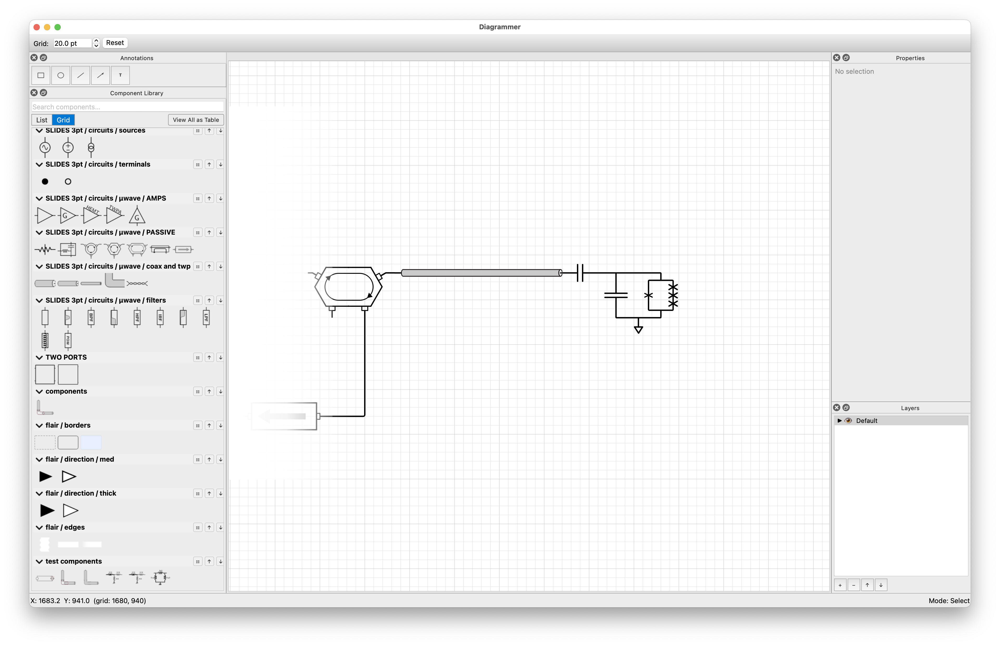

# Diagrammer

Diagrammer is a desktop app for building technical diagrams — circuit
schematics, flowcharts, block diagrams, and anything else you can express
with reusable SVG parts and routed connections — using a drag-and-drop
canvas. The current version focuses on electrical and wiring diagrams from the context of cryogenic microwave circuits and quantum measurement, but the approach is general and should work for any domain where you can define a library of components with connection points, including flowcharts, data pipelines, software architecture diagrams, and whatever else you might cook up.

Components are plain SVG files that you can easily author yourself, so the library grows with whatever domain you work in.



## What it does

Drop components from a library onto a snapping grid, wire them
together with KiCad-style orthogonal autorouting, and annotate the result
with text and LaTeX math. Components rotate, flip, and stretch; wires
auto-shorten leads into rounded corners; selections cut, copy, and paste
with their connection topology intact. Everything is undoable.

Components are simple SVGs with named layers (`artwork`,
`leads`, `ports`, `labels`, `stretch`). While Diagrammer ships with a lot of built-in components, you can also create your own in Inkscape or any SVG editor by following the spec in [src/diagrammer/docs/svg-component-spec.md](src/diagrammer/docs/svg-component-spec.md). Just drop your SVG files into categorized subdirectories under `components/` and they will appear in the library panel, or you can simply point to your library directory in the settings.

## Features

- **SVG component library** — drag-and-drop placement, search, favorites,
  and recently-used tracking. Components are plain SVG files you author.
- **KiCad-style wire routing** — orthogonal and 45° autorouting, manual
  waypoint placement, segment dragging, wire-to-wire T-junctions, end dots,
  and plain or hopped wire crossings.
- **Port-based connections** with snap-to-port, snap-to-grid, and
  snap-to-angle.
- **Component transforms** — 90° rotation, fine 15° rotation, horizontal
  and vertical flip, and stretchable bodies for variable-length parts.
- **Rounded wire corners** with dynamic lead shortening so junctions
  meet components seamlessly.
- **Wire direction arrows** — Ctrl+Alt+click a wire to drop a
  signal-flow arrow; drag it along the wire, double-click to flip, and
  style it (filled/hollow, size, outline) globally or per arrow.
- **Simple shape drawing** — rectangles, ellipses, and lines with
  editable properties and resize handles.
- **Annotations with LaTeX math** — inline `$...$` and display `$$...$$`
  (matrices, `align`, etc.) rendered as resolution-independent SVG. Text
  is converted to vector outlines on copy / SVG / PDF export so pasted
  output looks the same on machines without the source font installed.
  See [docs/math-annotations.md](docs/math-annotations.md) for rendering
  backends, optional system-LaTeX setup, and the recommended math fonts
  (CMU Serif, STIX Two Text) and how to install them on each platform.
- **Undo/redo** for every operation, plus cut/copy/paste that preserves
  connection topology.
- **Several diagrams at once**, one per tab, with copy and paste between them.
- **Paste into other apps** — Copy Selection as Image puts PDF, SVG and PNG
  on the clipboard for Keynote, PowerPoint, Illustrator, Inkscape, VectorCraft.
- **SVG images** — import or paste any SVG (a logo, a plot) as a resizable
  picture alongside your components.
- **Your own component copies** — edit a shipped component and Diagrammer
  saves *your* copy under `~/.diagrammer/components/`, leaving the shipped one
  intact and comparable; hide, move or revert components from the library.
- **Component inspector and validation** — check a part, or a whole library,
  for the defects that look fine but misbehave on the canvas (ports off the
  frame, leads not reaching ports, wrong lead weight), with previewed fixes.
- **Build diagrams with Claude** *(experimental)* — an MCP server lets Claude
  place, wire and render parts from the library and save a `.dgm` you finish
  by hand. See [docs/mcp.md](docs/mcp.md).
- **Zoom & pan** — scroll-wheel zoom at cursor, zoom-window mode, fit-all,
  and middle-click pan.
- **Configurable grid** with snap toggle and major/minor visual lines.
- **Persistent settings** for style preferences, routing options, and
  library visibility.

## Installation

### Prebuilt executables (recommended)

Download the latest build for your platform from the
[Releases page](https://github.com/w00ber/Diagrammer/releases/latest):

- **macOS** — `Diagrammer-macOS.zip`. Unzip and drag `Diagrammer.app` to
  `/Applications`. The first time you launch it, macOS will block it
  because the app is unsigned — right-click the app and choose **Open**,
  then confirm. After that it opens normally.
- **Windows** — `Diagrammer-Windows.zip`. Unzip anywhere and run
  `Diagrammer\Diagrammer.exe`. Keep the whole `Diagrammer` folder
  together; the `_internal` directory next to the `.exe` holds the
  bundled dependencies. SmartScreen may warn on first launch — choose
  **More info → Run anyway**.

### From source (for development)

Requires Python 3.10+ and PySide6.

```bash
pip install -e .
```

## Usage

```bash
python -m diagrammer
```

... but the package also provides an entry point:

```bash
diagrammer
```

that you can execute directly from the command line.

Press **?** in the app to toggle a floating on-canvas cheat-sheet of the
shortcuts relevant to your current selection, or **F1** for the full in-app
help reference. The overlay's default visibility and corner can be set in
**Settings → Appearance → Keyboard Shortcut Hints**.

## Keyboard Shortcuts

The full reference lives in [src/diagrammer/docs/help.md](src/diagrammer/docs/help.md) (also reachable
via **F1**). The bindings below are the **defaults** — they can be
overridden per-user in **Settings → Keyboard Shortcuts**, and the in-app
help reflects whatever the user has currently bound. The most-used
defaults:

| Key | Action |
|-----|--------|
| **Navigation** | |
| A | Zoom all / fit |
| Z | Zoom window mode |
| Middle-click drag | Pan |
| Scroll wheel | Zoom at cursor |
| Ctrl+/- | Zoom in/out (centered) |
| G | Show / hide grid |
| **Components** | |
| Space | Rotate 90° CCW |
| Shift+Space | Rotate 90° CW |
| R | Fine rotate 15° CCW |
| Shift+R | Fine rotate 15° CW |
| F | Flip horizontal |
| Shift+F | Flip vertical |
| Shift+click port | Set rotation pivot |
| **Routing** | |
| W | Toggle trace routing mode |
| Shift (while routing) | Constrain to H/V |
| D / Shift+D | Cycle a free wire end's dot |
| **Layers** | |
| Shift+H | Show / hide active layer |
| Shift+L | Lock / unlock active layer |
| **Selection & Alignment** | |
| Shift+click | Multi-select components |
| Ctrl+click port | Select port for alignment |
| Ctrl+Shift+H | Align horizontally |
| Ctrl+Shift+V | Align vertically |
| **Editing** | |
| Delete / Backspace | Delete selected |
| Ctrl+Z | Undo |
| Ctrl+Shift+Z | Redo |
| Ctrl+C / X / V | Copy / Cut / Paste |
| Ctrl+Shift+C | Copy selection as image (for other apps) |
| Ctrl+N / Ctrl+W | New diagram tab / close tab |
| Ctrl+Shift+] / [ | Next / previous tab |
| Ctrl+I | Inspect & validate component |
| Ctrl+, | Settings |
| Escape | Cancel current operation |
| **Help** | |
| ? | Toggle on-canvas shortcut hints |
| F1 | Open full help reference |

## Creating Components

Components are standard SVG files with named layers. See
[src/diagrammer/docs/svg-component-spec.md](src/diagrammer/docs/svg-component-spec.md) for the full
specification. You can open any of the built-in components in Inkscape or Adobe Illustrator to see how they are structured, or as a starting point to create your own.

Quick summary — an SVG component has these layers:

| Layer | Purpose |
|-------|---------|
| `artwork` | Component body (rendered) |
| `leads` | Connection stems (dynamically shortened for rounded corners) |
| `ports` | Connection points (`<circle id="port:name" .../>`) |
| `labels` | Text label placeholders |
| `stretch` | Break lines for stretchable components |

To check a component the way the app reads it, use **Library ▸ Inspect &
Validate Component** in the app, or from the command line:

```bash
python -m diagrammer.svglint path/to/component.svg
```

Place component SVGs in categorized subdirectories:

```
components/
  electrical/
    resistor.svg
    capacitor.svg
  flowchart/
    process.svg
```

Components you save from the app go to `~/.diagrammer/components/`, which is
scanned before the shipped library, so a copy there overrides the shipped part
of the same name without modifying it.

## Building diagrams with Claude (experimental)

Diagrammer ships an [MCP](https://modelcontextprotocol.io) server so Claude
Desktop or Claude Code can build diagrams from the component library: search
parts, place and wire them, render a preview to check its work, and save a
`.dgm` you then open and finish by hand. It runs locally with no window.

```bash
pip install -e ".[mcp]"
```

This is experimental — the tool set will change. Setup for each client, and
what to watch out for, is in [docs/mcp.md](docs/mcp.md).

## Building an app bundle/executable

You can use PyInstaller to create a standalone executable or app bundle for distribution on your own computer. First, install PyInstaller:

```bash
pip install pyinstaller
```

Then, run the following command from the root of the project:

```bash
pyinstaller diagrammer.spec
```
The app bundle or executable will be created in the `dist/` directory. For macOS, this will be `dist/Diagrammer.app`. For Windows, it will be `dist/diagrammer.exe` + a `_internal` directory that contains the necessary dependencies. You will need to distribute both the executable and the `_internal` directory together.

## Further reading

- [docs/math-annotations.md](docs/math-annotations.md) — LaTeX math
  syntax, rendering backends, and system-LaTeX setup.
- [src/diagrammer/docs/svg-component-spec.md](src/diagrammer/docs/svg-component-spec.md) — full SVG
  component specification.
- [src/diagrammer/docs/help.md](src/diagrammer/docs/help.md) — in-app help
  and complete shortcut reference.
- [docs/tutorial.md](docs/tutorial.md) — a walk-through building a first
  circuit (also Help ▸ Tutorial).
- [docs/mcp.md](docs/mcp.md) — the experimental MCP server.

## License

MIT
