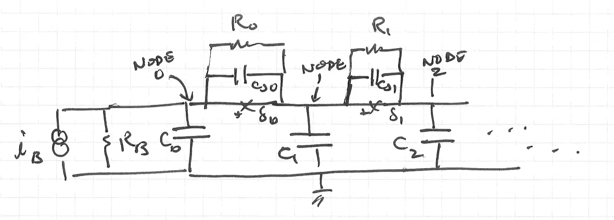
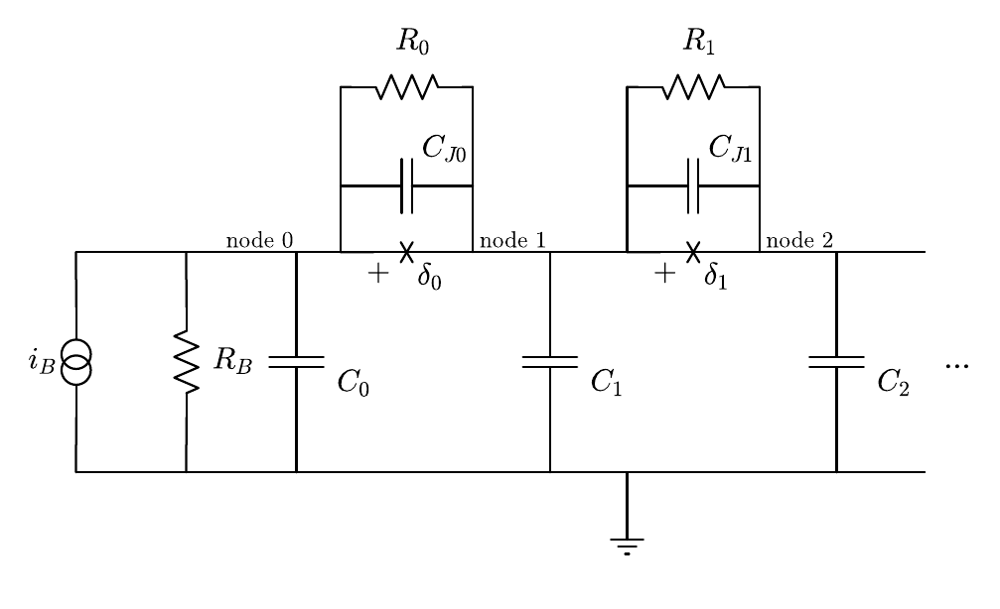
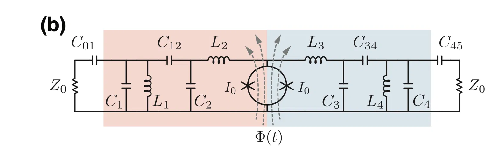
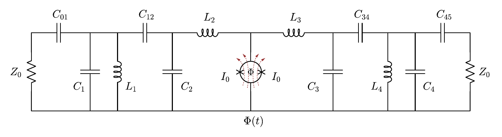

# Driving Diagrammer from Claude (MCP)

Diagrammer ships an [MCP](https://modelcontextprotocol.io) server so Claude can
build a diagram from the component library, look at it, and save a `.dgm` you
then finish by hand in the app. It runs locally over stdio, with no window, and
edits the scene through the same undo commands as the mouse — so the file it
writes is an ordinary diagram.

Status: **experimental.** The tool set is small and will change. Treat what it
draws as a starting point: it gets the parts, the wiring and the labels in
place, and you tidy spacing and details in the app. See
[Drawing from a picture](#drawing-from-a-picture) for worked examples.

## Install

```bash
~/miniforge3/envs/CMT/bin/pip install -e ".[mcp]"
```

This adds the `mcp` SDK (1.x and 2.x both work) and a `diagrammer-mcp` command.

## Connect it

**Claude Code** (from any directory):

```bash
claude mcp add diagrammer -- ~/miniforge3/envs/CMT/bin/diagrammer-mcp
```

**Claude Desktop** — add to `~/Library/Application Support/Claude/claude_desktop_config.json`:

```json
{
  "mcpServers": {
    "diagrammer": {
      "command": "/Users/<you>/miniforge3/envs/CMT/bin/diagrammer-mcp"
    }
  }
}
```

(**Settings → Developer → Edit Config** opens this file.) Use the absolute
path: Desktop does not activate conda or read your shell's `PATH`. Then quit
Desktop fully (⌘Q — closing the window is not enough) and reopen it. The tools
menu in a new chat should list `diagrammer`; if not, read
`~/Library/Logs/Claude/mcp-server-diagrammer.log`.

The plain claude.ai web chat cannot reach a local server.

## What Claude gets

| Tool | Does |
| ---- | ---- |
| `search_components`, `describe_component` | Find parts; list ports with the direction each lead points |
| `add_component` | Place a part so a chosen port (or its centre) lands on a point |
| `attach_component` | Place a part next to an existing port, turned to face it, and wire them — chains are repeated calls |
| `add_node`, `connect` | T-junctions; wires between existing ports |
| `add_text` | Labels; `$...$` is LaTeX |
| `move`, `remove`, `undo` | Fix layout |
| `get_diagram`, `render` | Inspect as JSON; see it as a PNG |
| `save_diagram`, `export_diagram`, `open_diagram` | `.dgm`; `.pdf`/`.svg`/`.png`; reopen a `.dgm` |

The server's instructions tell Claude the coordinate conventions and to render
and look before it is done. The same operations are a plain Python API in
`diagrammer.headless.Diagram`, for scripts:

```python
from diagrammer.headless import Diagram
d = Diagram()
d.add("PAPER_2pt/circuits/LCR/CAP1", (0, 0), anchor="left", id="C")
d.attach("PAPER_2pt/circuits/gnds/GND1", "left", to=("C", "right"))
d.save("~/Desktop/rc.dgm")
```

## Drawing from a picture

The most useful thing to do with the server is to hand Claude a picture, such as
a whiteboard photo, a pencil sketch, or a figure from a paper, and get back a
`.dgm` with the circuit already laid out. **The result is not perfect.** It is
good for setting up the baseline geometry, meaning which parts, how they are
wired, and roughly where they sit, and you then tweak it by hand. That is
usually the slow part of drawing a schematic from scratch.

In Claude Desktop, attach the image to the chat. In Claude Code, paste it or
give its path. The prompt can be very short: both examples below were drawn
from a one-line request, and in both Claude picked the `PAPER_2pt` library on
its own.

### Example 1: a hand sketch

A hand-drawn RCSJ junction chain:



The prompt, with the sketch attached:

> Do you have access to the Diagrammer MCP? Can you reproduce this figure as
> Diagrammer file?

Result, as exported from the saved `.dgm`
([rcsj_chain.dgm](mcp-examples/rcsj_chain.dgm)):



The handwriting was read into proper labels ($R_0$, $C_{J0}$, $\delta_0$, …),
and the "NODE" arrows became text labels on the rail.

### Example 2: redrawing a published figure

Fig. 14(b) of O. Naaman and J. Aumentado, "Synthesis of parametrically coupled
networks", *PRX Quantum* **3**, 020201 (2022):



The prompt:

> Ok- now try to reproduce Fig14(b) of the Naaman and Aumentado PRXQ (2022)

**Claude has to see the figure.** This prompt first sent Claude to a paper
library connected through another MCP server, which returned the paper's text
but not its figures. From the text alone, Claude listed the parts and their
values, but it could only guess where the SQUID connects, and it said so and
asked for the image. Pasting a screenshot of the figure fixed that. If a tool
hands Claude a paper but not its images, paste the figure.

Result ([naaman2022_fig14b.dgm](mcp-examples/naaman2022_fig14b.dgm)):



The topology and labels came across. The shaded background regions were
dropped, and the dashed flux lines are approximated by the SQUID part's own
flux arrows. Those are the kind of details you finish in the app.

### When the first try misses

Start short, as above, and add detail only where the result is wrong:

- **Point at specific problems**, for example "C2 should be to the right of
  L1" or "one ground under the bottom rail", rather than saying "tidy it up".
  Claude checks its work by rendering the diagram and looking at it.
- **Name the library** (`PAPER_2pt`, `SLIDES_3pt`, `CRYO_WIRING_6pt`) if you
  want a different one from the one Claude picked. It sets the line weight of
  the whole diagram.
- **List the labels** if a hand-written one was misread.
- **Say what to leave out.** Shading, annotations and decorative arrows are
  easier to add by hand than to get right through the tools.
- **Save early, then finish in the app.** The `.dgm` is an ordinary diagram.
  To keep working with Claude later, have it `open_diagram` the file in a new
  chat. The ids then become the file's 12-hex instance ids, not the short names
  used while drawing.

## Things that will trip you up

- **Port names are not directions.** In the shipped library a capacitor's
  `left` port points *up*. Tools report a `points` field computed from the
  geometry after rotation and flip; Claude is told to use it.
- **Short ids are not saved.** `J1`, `Cc` live only in the server session; a
  reopened `.dgm` uses its 12-hex instance ids.
- **One diagram per server process.** `new_diagram` discards the current one.
  Desktop appears to run one server for all chats, so two chats drawing at
  once would share — and overwrite — the same diagram.
- **Restart to pick up changes.** The server reads the component library and
  its own code once, at startup: after a `git pull`, a branch switch, or a new
  component, restart the client.

## Costs

- **Memory:** about 100 MB idle (mostly the MCP SDK and Qt; the component
  library itself is ~3 MB), about 155 MB once a LaTeX label has loaded
  matplotlib. No CPU when idle.
- **Context:** the tool definitions are ~2,000 tokens in every chat where the
  server is enabled — switch it off per chat when you are not drawing. Each
  `render` returns an image, roughly 1–1.5k tokens; render after a batch of
  edits rather than after each one.

## For developers

Two rules in `mcp_server.py` prevent silent failures — read its docstring
before adding a tool:

1. Every tool is `async`. The SDK runs sync tools in a worker thread, and Qt
   scene/painter objects must stay on the thread that owns the `QApplication`.
2. Every tool is wrapped in `_quiet`: stdout is the protocol channel, so
   prints are routed to stderr, and errors are re-raised as `ToolError` so the
   model sees the message (mcp 2.x otherwise hides it).

Tests: `tests/test_headless.py`.
